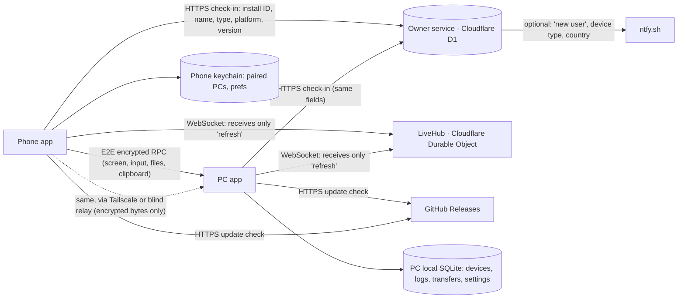

> **DRAFT.** Voluntary PIA based on the source code at the commit that introduced this file.

# Privacy Impact Assessment

## 1. Data categories
| Category | Examples | Sensitivity |
|---|---|---|
| Identifiers | Random install ID, device public keys | Low (pseudonymous) |
| Self-chosen display name | "Dani's iPhone", computer name | Low–medium (can identify a person) |
| Device/technical | Device type, platform, app version, country code | Low |
| Usage | Days active, version per day | Low |
| Security logs (PC, local) | Device name, local/Tailscale IP, time, action | Medium (local only) |
| Remote-session content | Screen images, keystrokes, clipboard, files | **High** – processed only between the user's own devices, never stored or sent to the operator |
| Reports | Free text, optional contact | Medium (voluntary) |
| Hashed network address | Truncated SHA-256 of IP, ≤ 2 days | Low–medium (pseudonymous) |

## 2. Purposes
Running remote control between a user's own devices; operator administration (lock, block, invites, updates, messages); security (rate limiting, audit log); usage statistics; handling abuse reports.

## 3. Data flows

## 4. Risks and mitigations
| # | Risk | Likelihood / impact | Mitigation in place | Residual |
|---|---|---|---|---|
| R1 | Someone pairs a phone with another person's PC to spy on them | Medium / high | Pairing requires physical approval on the PC + matching verification code; visible indicators; security log; revoke & emergency shortcut; AUP; no stealth mode | Medium – a person with physical access to an unlocked PC can still approve; mitigated by indicators and logs |
| R2 | Unauthorized tracking of a person | Low / high | No location collected; location feature blocked by policy rules | Low |
| R3 | Covert camera/microphone use | Low / high | No camera/mic capture of the PC; phone camera used only for QR scanning; Android RECORD_AUDIO blocked | Low |
| R4 | Network attacker reads/alters sessions | Low / high | E2E encryption with authenticated keys, nonce ordering | Low |
| R5 | Owner service compromise exposes names/device data | Low / medium | Minimal data, no IPs, TLS, server-side admin code, hashed tokens, audit log, retention purge | Low–medium |
| R6 | Operator misuses admin powers (e.g. reading data) | Low / medium | Operator cannot access devices, screens or files – only app-level lock/block/messages; actions logged | Low |
| R7 | Malicious update | Low / high | HTTPS + checksums from GitHub; minimum-version mechanism for fast fixes | Medium – installer not code-signed |
| R8 | Children use the app | Low / medium | 18+ terms; no child features | Low |
| R9 | Cross-border transfer to US providers | Certain / low | Minimal data; providers' DPAs [to be signed/confirmed] | Low |
| R10 | Brute-force of admin/invite codes | Medium / medium | Rate limits per network & install, visible to operator | Low |
| R11 | Data kept too long | Medium / low | Automated retention purge; local deletion controls | Low |

## 5. Conclusion
Residual risk is acceptable for the current private user group, **conditional on** completing the release-blocking items in [LEGAL_COMPLIANCE_CHECKLIST.md](LEGAL_COMPLIANCE_CHECKLIST.md) before any public distribution (code signing, legal review, licence choice, processor agreements). A formal DPIA under GDPR Art. 35 should be performed before introducing location, camera, microphone or phone-control features, or before public EU distribution.

---

# תסקיר השפעה על הפרטיות (סיכום)
קטגוריות מידע: מזהים אקראיים, שם שנבחר, נתוני מכשיר, ימי שימוש, יומני אבטחה מקומיים, תוכן שליטה מרחוק (מסך/הקלדות/קבצים – **לא נשמר ולא נשלח למפעיל**), דיווחים. סיכונים עיקריים: צימוד למחשב של אדם אחר לצורך ריגול (מוקטן ע״י אישור פיזי במחשב, חיוויים, יומן וביטול); מעקב מיקום (אין איסוף מיקום); מצלמה/מיקרופון סמויים (אין); דליפה משירות הבעלים (מידע מינימלי, ללא IP, מחיקה אוטומטית); עדכון זדוני (המתקין עוד לא חתום). מסקנה: סיכון שארי סביר לקבוצה הפרטית הנוכחית, בתנאי השלמת הסעיפים החוסמים לפני הפצה ציבורית.
